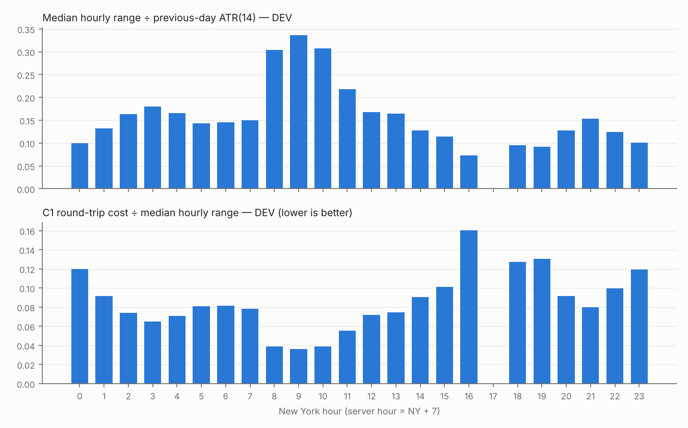
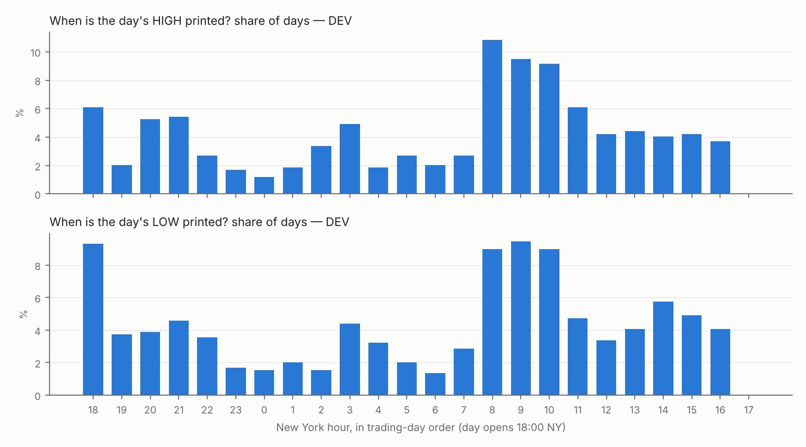
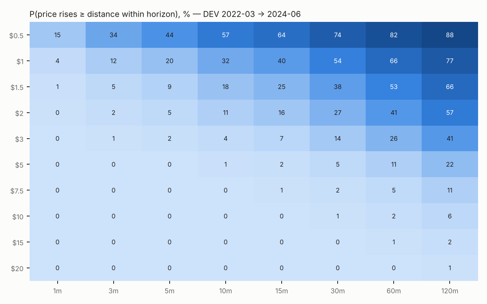

# Phase 2 — XAUUSD Behavior Atlas

_Generated by `src/atlas.py` → tables in `reports/tables/atlas_*.csv` → this file by `src/atlas_report.py`. Figures in `reports/figures/`._

## 0. Protocol

* **Discovery set (DEV):** 2022-03-16 → 2024-06-30. **Replication set (VAL):** 2024-07-02 → 2025-06-30. **Holdout (2025-07 →) was not loaded.**
* A pattern is called **robust** only if it is significant in DEV (|z| ≥ 3, which also absorbs most of the multiple-testing burden of this atlas) **and** has the same sign with |z| ≥ 2 in VAL.
* Prices are Bid. Distances are in **USD of price**; "ATR" normalisations use only information available at decision time (previous-day ATR(14); ATR(14) of *completed* M15 bars).
* Cost yardstick: **C1 round trip = $0.30** (real spread $0.10 + $0.10 adverse slippage each side on market/stop orders, Phase 1b).
* This phase **describes** the market. Nothing here is yet a strategy; findings become hypotheses for Phase 3, where they are tested with entries, stops, costs and walk-forward validation.

## 1. Executive summary

1. **Gold behaves very close to a random walk in *direction* at every intraday horizon tested.** Up and down barriers of the same size are hit with almost identical probability; P(up barrier first) stays within ≈49–51%, and the small deviations track the period's trend (2022 down-year < 50%, 2024–25 up-years > 50%; table §6.3). No session, hour or weekday has a reliable directional bias.
2. **Volatility, by contrast, is highly predictable.** |return| autocorrelation is ≈0.2–0.3 on M1–M15 in both sets, and after an expansion bar (range ≥ 2 ATR) the next bar's range averages 1.5–1.95 ATR, versus 0.6–0.86 after compression. This is the most reliable property in the data: **it can tell us *when* and *how far* to aim, not *which way*.**
3. **Costs decide the timeframe.** C1 costs 73% of the median M1 bar in DEV (41% in VAL), 29% of an M5 bar, 16% of an M15 bar and 8% of an H1 bar. **Market-order scalping on M1 targets is not viable;** realistic targets start around $2–3 (2022–24 prices) / ≈1 ATR15, or require limit-order entries.
4. **The day has a clear rhythm.** The 08:00–11:00 NY window (London–NY overlap: data releases and the cash open) is the most volatile (0.32 of daily ATR per hour vs 0.11 for 23:00–01:00 NY). Per hour, it is also where the day's high or low is most likely to be printed (9.5% of days per hour per extreme in DEV, 7.6% in VAL, vs 4.3% if uniform); the Asia open 18:00–22:00 NY is second (5.0% / 7.1% per hour).
5. **Robust conditional effects found are small and mostly *mean-reverting*:** after a strong M1 displacement candle the next minute continues only 47.1% (DEV) / 47.7% (VAL), and the 3-minute follow-through is negative (-0.034 $ / -0.064 $). Real, but **far smaller than the $0.30 cost**. The last NY hour (16:00–17:00 NY) reverses the previous hour's direction more often than chance (P(continue) 43.2% DEV, z=-3.2; 42.7% VAL, z=-2.3).
6. **Classical candle patterns (engulfing, inside bar, pin/rejection) show no robust edge on any timeframe; streak effects on M5/M15 are detectable but economically nil.**

## 2. Time-of-day profile (H1 bars built from M1)

Columns: median H1 range in $ and ÷ previous-day ATR(14); VR5 = variance ratio of 5-min vs 1-min returns inside the hour (1 = random walk, < 1 = short-term mean reversion, > 1 = persistence); false breakout = share of one-sided breaks of the previous hour's high/low that close back inside it; P_cont = P(this hour's direction = previous hour's direction); cost = C1 ÷ median hourly range.

| ny_hour | srv_hour | range_med_$_dev | range_med_$_val | range_vs_ATRd_med_dev | range_vs_ATRd_med_val | VR5_dev | VR5_val | false_bo_rate_dev | P_cont_prev_hour_dev | z_cont_dev | P_cont_prev_hour_val | z_cont_val | cost_C1_vs_med_range_dev | cost_C1_vs_med_range_val |
|---|---|---|---|---|---|---|---|---|---|---|---|---|---|---|
| 18 | 1 | 2.360 | 4.480 | 0.095 | 0.107 | 0.972 | 0.996 |  |  |  |  |  | 0.127 | 0.067 |
| 19 | 2 | 2.300 | 3.940 | 0.092 | 0.098 | 1.000 | 0.954 | 0.443 | 0.479 | -1.032 | 0.496 | -0.125 | 0.130 | 0.076 |
| 20 | 3 | 3.280 | 6.360 | 0.128 | 0.146 | 1.004 | 0.994 | 0.338 | 0.481 | -0.909 | 0.512 | 0.375 | 0.091 | 0.047 |
| 21 | 4 | 3.750 | 7.440 | 0.153 | 0.187 | 1.035 | 0.948 | 0.377 | 0.505 | 0.247 | 0.518 | 0.561 | 0.080 | 0.040 |
| 22 | 5 | 3.020 | 6.210 | 0.124 | 0.151 | 0.996 | 0.926 | 0.455 | 0.492 | -0.412 | 0.494 | -0.187 | 0.099 | 0.048 |
| 23 | 6 | 2.520 | 4.900 | 0.101 | 0.126 | 0.931 | 0.918 | 0.515 | 0.520 | 0.949 | 0.506 | 0.187 | 0.119 | 0.061 |
| 0 | 7 | 2.500 | 4.810 | 0.100 | 0.119 | 0.946 | 0.810 | 0.462 | 0.496 | -0.206 | 0.514 | 0.437 | 0.120 | 0.062 |
| 1 | 8 | 3.280 | 6.420 | 0.133 | 0.160 | 0.946 | 0.988 | 0.446 | 0.458 | -2.058 | 0.502 | 0.062 | 0.091 | 0.047 |
| 2 | 9 | 4.060 | 7.450 | 0.164 | 0.179 | 0.987 | 0.966 | 0.407 | 0.476 | -1.155 | 0.512 | 0.375 | 0.074 | 0.040 |
| 3 | 10 | 4.600 | 7.460 | 0.180 | 0.190 | 0.995 | 1.043 | 0.376 | 0.488 | -0.577 | 0.525 | 0.814 | 0.065 | 0.040 |
| 4 | 11 | 4.220 | 6.530 | 0.165 | 0.164 | 0.956 | 0.931 | 0.447 | 0.514 | 0.702 | 0.490 | -0.313 | 0.071 | 0.046 |
| 5 | 12 | 3.710 | 5.880 | 0.143 | 0.152 | 0.942 | 0.905 | 0.485 | 0.481 | -0.909 | 0.512 | 0.375 | 0.081 | 0.051 |
| 6 | 13 | 3.690 | 6.070 | 0.145 | 0.152 | 0.990 | 0.967 | 0.473 | 0.485 | -0.742 | 0.465 | -1.125 | 0.081 | 0.049 |
| 7 | 14 | 3.830 | 6.450 | 0.150 | 0.164 | 0.954 | 0.958 | 0.502 | 0.482 | -0.865 | 0.477 | -0.750 | 0.078 | 0.047 |
| 8 | 15 | 7.670 | 10.220 | 0.304 | 0.257 | 0.929 | 0.914 | 0.287 | 0.499 | -0.041 | 0.521 | 0.686 | 0.039 | 0.029 |
| 9 | 16 | 8.300 | 12.080 | 0.336 | 0.307 | 0.963 | 0.960 | 0.420 | 0.475 | -1.193 | 0.502 | 0.062 | 0.036 | 0.025 |
| 10 | 17 | 7.760 | 12.025 | 0.308 | 0.288 | 1.076 | 1.011 | 0.452 | 0.494 | -0.288 | 0.484 | -0.500 | 0.039 | 0.025 |
| 11 | 18 | 5.430 | 8.630 | 0.218 | 0.205 | 0.993 | 0.952 | 0.475 | 0.486 | -0.699 | 0.480 | -0.625 | 0.055 | 0.035 |
| 12 | 19 | 4.180 | 6.740 | 0.167 | 0.171 | 1.000 | 0.950 | 0.520 | 0.475 | -1.195 | 0.510 | 0.312 | 0.072 | 0.045 |
| 13 | 20 | 4.030 | 5.985 | 0.164 | 0.149 | 1.014 | 0.895 | 0.456 | 0.526 | 1.239 | 0.441 | -1.875 | 0.074 | 0.050 |
| 14 | 21 | 3.310 | 4.810 | 0.128 | 0.121 | 1.118 | 1.038 | 0.452 | 0.498 | -0.084 | 0.520 | 0.635 | 0.091 | 0.062 |
| 15 | 22 | 2.970 | 4.845 | 0.115 | 0.122 | 0.951 | 0.978 | 0.504 | 0.520 | 0.968 | 0.536 | 1.143 | 0.101 | 0.062 |
| 16 | 23 | 1.870 | 3.655 | 0.073 | 0.089 | 0.995 | 0.733 | 0.511 | 0.432 | -3.212 | 0.427 | -2.286 | 0.160 | 0.082 |

**Reading**
* Busiest hours (by ATR-normalised range, DEV): NY [9, 10, 8]. Quietest: NY [16, 19, 18].
* VR5 averages 0.987 (DEV) and 0.945 (VAL): minute-to-minute moves slightly **mean-revert inside the hour** — consistent with the negative M1 lag-1/2 autocorrelation in §5.2.
* Hour-to-hour direction: only 1 of 22 hours reach |z| > 3 in DEV. The last hour before the halt (NY 16:00, server 23:00) is the one that also replicates in VAL; it trades on the thinnest range of the day (median $1.87 DEV), so its cost burden (16% of range) is the highest of any hour.
* "False breakouts" of the previous hour's range are frequent everywhere (≈30–50%). This is a base rate, not an edge: any breakout rule must beat it.

## 3. Day of week (daily bars)

| split | dow | n | range_med_$ | range_vs_ATRd_med | ret_mean_ATR | P_up | z_up |
|---|---|---|---|---|---|---|---|
| dev | Mon | 112 | 20.135 | 0.802 | -0.073 | 0.509 | 0.189 |
| dev | Tue | 116 | 23.265 | 0.887 | 0.024 | 0.552 | 1.114 |
| dev | Wed | 117 | 22.940 | 0.925 | 0.052 | 0.487 | -0.277 |
| dev | Thu | 117 | 24.150 | 0.945 | 0.070 | 0.530 | 0.647 |
| dev | Fri | 114 | 24.820 | 0.999 | 0.124 | 0.579 | 1.686 |
| val | Mon | 52 | 38.230 | 0.941 | -0.008 | 0.500 | 0.000 |
| val | Tue | 52 | 36.860 | 0.915 | 0.258 | 0.673 | 2.496 |
| val | Wed | 50 | 36.080 | 0.861 | 0.009 | 0.540 | 0.566 |
| val | Thu | 52 | 41.265 | 1.050 | 0.231 | 0.596 | 1.387 |
| val | Fri | 51 | 34.960 | 0.996 | 0.049 | 0.490 | -0.140 |

No weekday reaches |z| ≥ 2.5 for direction in either set (largest: val Tue, z=2.50, which is z=1.11 in the other set) — **day-of-week is rejected as a directional filter**. Ranges are lowest on Monday in DEV, but this does not hold in VAL.

## 4. Sessions, opens and reference levels

Session clock (DST-correct): Asia 19:00–02:00 NY · London 08:00–16:30 London · New York 08:00–17:00 NY · overlap = London ∩ New York · Off-hours = the rest (reopen hour 18:00 NY and 02:00–03:00 NY).

### 4.1 Session ranges

| split | session | days | minutes_med | range_med_$ | range_vs_ATRd_med | range_per_hour_vs_ATRd | P_sets_day_high | P_sets_day_low | cost_C1_vs_med_range |
|---|---|---|---|---|---|---|---|---|---|
| dev | Asia | 591 | 420.000 | 8.370 | 0.326 | 0.047 | 0.201 | 0.210 | 0.036 |
| dev | LDN-NY overlap | 591 | 210.000 | 15.090 | 0.597 | 0.168 | 0.323 | 0.310 | 0.020 |
| dev | London | 591 | 300.000 | 9.370 | 0.363 | 0.074 | 0.142 | 0.134 | 0.032 |
| dev | New York | 591 | 329.000 | 8.270 | 0.328 | 0.061 | 0.239 | 0.234 | 0.036 |
| dev | Off-hours | 591 | 120.000 | 7.650 | 0.306 | 0.149 | 0.096 | 0.113 | 0.039 |
| val | Asia | 257 | 420.000 | 16.500 | 0.417 | 0.060 | 0.230 | 0.268 | 0.018 |
| val | LDN-NY overlap | 257 | 210.000 | 22.000 | 0.534 | 0.149 | 0.257 | 0.268 | 0.014 |
| val | London | 257 | 300.000 | 14.690 | 0.354 | 0.075 | 0.117 | 0.089 | 0.020 |
| val | New York | 257 | 329.000 | 13.110 | 0.339 | 0.064 | 0.276 | 0.179 | 0.023 |
| val | Off-hours | 257 | 120.000 | 14.240 | 0.373 | 0.182 | 0.121 | 0.195 | 0.021 |

The overlap prints the largest range per hour of the day (`range_per_hour_vs_ATRd`) and sets the day's high or low on 32% / 31% of days (DEV). Cost relative to a whole session's range is small everywhere (2–4%), so **session-scale (intraday) targets are cost-feasible**; minute-scale targets are not.

### 4.2 When the day's high and low are printed

Average share of days on which the high/low is printed in the window (per extreme): 08:00–11:00 NY 28.4% DEV / 22.8% VAL; 18:00–22:00 NY (Asia open) 20.1% / 28.2%; 23:00–02:00 NY 5.0% / 4.7%. Full table: `reports/tables/atlas_day_high_low_timing.csv`. The "kill zone" idea that the day's extremes cluster around the London/NY morning is **supported as a timing statement** (where extremes form), not as a directional signal.

### 4.3 Opening ranges (first 30 minutes after each open)

| split | open | days | OR_width_med_$ | P_break_up_first | P_break_down_first | P_no_break | P_break_both | P_close_beyond_OR_after_break | P_close_back_inside_after_break | P_rest_same_dir_as_OR | z_same_dir |
|---|---|---|---|---|---|---|---|---|---|---|---|
| dev | Asia 19:00 NY | 591 | 1.590 | 0.528 | 0.472 | 0.000 | 0.750 | 0.501 | 0.154 | 0.503 | 0.165 |
| dev | London 08:00 LDN | 591 | 3.410 | 0.477 | 0.516 | 0.007 | 0.403 | 0.506 | 0.308 | 0.495 | -0.247 |
| dev | NY data 08:30 NY | 591 | 5.810 | 0.472 | 0.503 | 0.025 | 0.393 | 0.530 | 0.276 | 0.488 | -0.576 |
| dev | NY cash 09:30 NY | 591 | 6.570 | 0.489 | 0.459 | 0.052 | 0.237 | 0.507 | 0.366 | 0.501 | 0.041 |
| val | Asia 19:00 NY | 257 | 2.750 | 0.549 | 0.451 | 0.000 | 0.735 | 0.549 | 0.097 | 0.467 | -1.060 |
| val | London 08:00 LDN | 256 | 5.500 | 0.582 | 0.406 | 0.012 | 0.453 | 0.478 | 0.296 | 0.486 | -0.438 |
| val | NY data 08:30 NY | 256 | 7.815 | 0.555 | 0.445 | 0.000 | 0.492 | 0.477 | 0.242 | 0.512 | 0.375 |
| val | NY cash 09:30 NY | 257 | 9.450 | 0.479 | 0.482 | 0.039 | 0.237 | 0.510 | 0.352 | 0.512 | 0.375 |

* The direction of the first 30 minutes says nothing about the rest of the session (P_same_dir ≈ 50% everywhere, |z| < 1.1).
* After the first break of the opening range, the window closes beyond it in the break direction only ≈48–55% of the time. **Opening-range direction carries no edge in itself**; ORB can only work, if at all, through volatility/expansion filters and exits — a Phase 3 hypothesis, not a finding.

### 4.4 Asian range and previous-day high/low

| split | level | days | P_take_high | P_take_low | P_take_both | P_take_neither | P_close_back_inside_given_high_taken_only | P_close_back_inside_given_low_taken_only |
|---|---|---|---|---|---|---|---|---|
| dev | Asian range (in London+NY) | 591 | 0.728 | 0.706 | 0.442 | 0.008 | 0.266 | 0.231 |
| dev | Previous-day high/low | 590 | 0.492 | 0.478 | 0.114 | 0.144 | 0.408 | 0.428 |
| val | Asian range (in London+NY) | 257 | 0.685 | 0.580 | 0.284 | 0.019 | 0.214 | 0.289 |
| val | Previous-day high/low | 256 | 0.559 | 0.383 | 0.094 | 0.152 | 0.370 | 0.486 |

* London+NY take out the Asian high on ≈70% of days and the Asian low on ≈60–70%; when only one side is taken, the day closes back inside the Asian range just 21–29% of the time — i.e. **one-sided Asian-range breaks usually hold to the close**. That is the raw material for an Asian-range-breakout hypothesis (Phase 3), not yet an edge (no entry, stop or cost applied).
* Previous-day high/low is taken on ≈38–56% of days; after a one-sided take the day closes back inside 37–49% of the time — roughly a coin flip, so a "PDH/PDL sweep-and-reverse" idea needs extra conditions to beat its base rate.

## 5. Candle behaviour

### 5.1 Anatomy and cost by timeframe

| split | tf | bars | range_med_$ | body/range_med | upper_wick/range_med | lower_wick/range_med | P_up_bar | P_doji(body<10%) | cost_C1_vs_med_range |
|---|---|---|---|---|---|---|---|---|---|
| dev | 1min | 811499 | 0.410 | 0.526 | 0.176 | 0.188 | 0.488 | 0.094 | 0.732 |
| dev | 5min | 162388 | 1.020 | 0.479 | 0.209 | 0.218 | 0.498 | 0.099 | 0.294 |
| dev | 15min | 54048 | 1.820 | 0.462 | 0.221 | 0.228 | 0.500 | 0.102 | 0.165 |
| dev | 1h | 13525 | 3.730 | 0.445 | 0.229 | 0.240 | 0.506 | 0.107 | 0.080 |
| val | 1min | 352768 | 0.730 | 0.517 | 0.186 | 0.192 | 0.500 | 0.091 | 0.411 |
| val | 5min | 70595 | 1.780 | 0.470 | 0.213 | 0.224 | 0.510 | 0.098 | 0.169 |
| val | 15min | 23494 | 3.165 | 0.454 | 0.223 | 0.239 | 0.514 | 0.105 | 0.095 |
| val | 1h | 5881 | 6.520 | 0.445 | 0.224 | 0.245 | 0.533 | 0.104 | 0.046 |

### 5.2 Autocorrelation (within-day returns; band_95 = ±2/√n)

| tf | lag | acf_absret_dev | acf_absret_val | acf_ret_dev | acf_ret_val | band_95_dev | band_95_val |
|---|---|---|---|---|---|---|---|
| 15min | 1 | 0.2586 | 0.2564 | -0.0014 | -0.0062 | 0.0087 | 0.0131 |
| 15min | 2 | 0.2181 | 0.2331 | 0.0062 | 0.0127 | 0.0087 | 0.0131 |
| 15min | 3 | 0.1844 | 0.2161 | -0.0104 | -0.0002 | 0.0087 | 0.0131 |
| 15min | 5 | 0.1570 | 0.1640 | 0.0098 | 0.0159 | 0.0087 | 0.0131 |
| 15min | 10 | 0.0837 | 0.1134 | -0.0054 | 0.0083 | 0.0087 | 0.0131 |
| 1h | 1 | 0.2282 | 0.1956 | 0.0001 | -0.0291 | 0.0176 | 0.0267 |
| 1h | 2 | 0.1243 | 0.1662 | 0.0047 | -0.0036 | 0.0176 | 0.0267 |
| 1h | 3 | 0.0791 | 0.0752 | -0.0091 | 0.0229 | 0.0176 | 0.0267 |
| 1h | 5 | 0.0412 | 0.0891 | 0.0064 | -0.0372 | 0.0176 | 0.0267 |
| 1h | 10 | -0.0309 | 0.0871 | 0.0023 | 0.0243 | 0.0176 | 0.0267 |
| 1min | 1 | 0.3042 | 0.3083 | -0.0094 | -0.0079 | 0.0022 | 0.0034 |
| 1min | 2 | 0.2803 | 0.2816 | -0.0098 | -0.0176 | 0.0022 | 0.0034 |
| 1min | 3 | 0.2636 | 0.2734 | -0.0044 | -0.0082 | 0.0022 | 0.0034 |
| 1min | 5 | 0.2522 | 0.2651 | 0.0018 | 0.0067 | 0.0022 | 0.0034 |
| 1min | 10 | 0.2378 | 0.2451 | 0.0080 | -0.0013 | 0.0022 | 0.0034 |
| 5min | 1 | 0.2944 | 0.2856 | -0.0049 | 0.0117 | 0.0050 | 0.0075 |
| 5min | 2 | 0.2671 | 0.2631 | 0.0041 | 0.0065 | 0.0050 | 0.0075 |
| 5min | 3 | 0.2451 | 0.2446 | 0.0016 | -0.0049 | 0.0050 | 0.0075 |
| 5min | 5 | 0.2158 | 0.2349 | 0.0009 | -0.0023 | 0.0050 | 0.0075 |
| 5min | 10 | 0.1835 | 0.1992 | -0.0046 | 0.0025 | 0.0050 | 0.0075 |

* Returns: tiny **negative** lag-1/2 autocorrelation on M1 (≈ −0.01, well outside the band in both sets). Nothing reliable on M5–H1.
* |Returns|: strong positive autocorrelation everywhere (**volatility clustering**), decaying slowly on M1–M15.

### 5.3 Conditional next-bar behaviour

`P_next_bar_continues` = P(next bar moves in the signal direction | non-zero body); `fwd3` = 3-bar close-to-close move in the signal direction (mean, $ and ATR). **robust** = |z| ≥ 3 in DEV and same-sign |z| ≥ 2 in VAL.

| tf | condition | n_dev | P_next_bar_continues_dev | z_vs_50_dev | fwd3_ATR_mean_dev | fwd3_$_mean_dev | n_val | P_next_bar_continues_val | z_vs_50_val | fwd3_ATR_mean_val | fwd3_$_mean_val | robust |
|---|---|---|---|---|---|---|---|---|---|---|---|---|
| 15min | [baseline] P(bar up | non-zero body) | 54048 | 0.502 |  |  |  | 23494 | 0.515 |  |  |  |  |
| 15min | big displacement (body>=2.5 ATR) | 418 | 0.448 | -2.106 | -0.047 | -0.183 | 175 | 0.446 | -1.436 | -0.076 | -0.019 |  |
| 15min | displacement (body>=1.5 ATR, body>=60% range) | 2076 | 0.464 | -3.295 | -0.012 | -0.041 | 893 | 0.484 | -0.970 | 0.015 | 0.174 |  |
| 15min | engulfing (trade in engulfing direction) | 9306 | 0.484 | -3.093 | -0.022 | -0.040 | 4681 | 0.488 | -1.594 | -0.001 | -0.018 |  |
| 15min | inside bar (trade with prior 5-bar trend) | 7749 | 0.492 | -1.468 | -0.005 | -0.024 | 3228 | 0.491 | -1.075 | -0.020 | -0.057 |  |
| 15min | rejection: lower wick>=60%, range>=1 ATR (fade = long) | 1496 | 0.496 | -0.285 | -0.042 | -0.150 | 705 | 0.483 | -0.905 | 0.079 | 0.115 |  |
| 15min | rejection: upper wick>=60%, range>=1 ATR (fade = short) | 1400 | 0.481 | -1.444 | -0.097 | -0.177 | 519 | 0.478 | -1.010 | -0.095 | -0.143 |  |
| 15min | streak=1 same-colour bars | 26878 | 0.487 | -4.216 | -0.005 | -0.010 | 11623 | 0.491 | -1.950 | -0.003 | -0.004 |  |
| 15min | streak=2 same-colour bars | 13070 | 0.486 | -3.294 | -0.004 | -0.009 | 5685 | 0.487 | -1.939 | -0.015 | -0.077 |  |
| 15min | streak=3 same-colour bars | 6355 | 0.472 | -4.389 | 0.019 | 0.024 | 2755 | 0.480 | -2.118 | 0.002 | -0.022 | YES |
| 15min | streak=4 same-colour bars | 2969 | 0.496 | -0.404 | 0.048 | 0.096 | 1311 | 0.494 | -0.442 | -0.005 | -0.085 |  |
| 15min | streak=5 same-colour bars | 1472 | 0.489 | -0.862 | -0.032 | -0.031 | 648 | 0.491 | -0.471 | 0.008 | -0.015 |  |
| 15min | streak=6 same-colour bars | 713 | 0.469 | -1.651 | -0.041 | -0.090 | 319 | 0.498 | -0.056 | 0.006 | 0.080 |  |
| 1h | [baseline] P(bar up | non-zero body) | 13525 | 0.507 |  |  |  | 5881 | 0.534 |  |  |  |  |
| 1h | big displacement (body>=2.5 ATR) | 131 | 0.481 | -0.437 | -0.305 | -1.209 | 39 | 0.385 | -1.441 | -0.068 | -0.368 |  |
| 1h | displacement (body>=1.5 ATR, body>=60% range) | 562 | 0.476 | -1.142 | -0.067 | -0.143 | 235 | 0.434 | -2.022 | -0.181 | -1.142 |  |
| 1h | engulfing (trade in engulfing direction) | 2050 | 0.510 | 0.884 | -0.014 | 0.007 | 958 | 0.520 | 1.261 | 0.017 | 0.072 |  |
| 1h | inside bar (trade with prior 5-bar trend) | 1657 | 0.500 | 0.000 | -0.011 | -0.020 | 712 | 0.482 | -0.974 | 0.070 | 0.694 |  |
| 1h | rejection: lower wick>=60%, range>=1 ATR (fade = long) | 308 | 0.529 | 1.026 | 0.124 | 0.753 | 158 | 0.589 | 2.228 | 0.169 | 0.838 |  |
| 1h | rejection: upper wick>=60%, range>=1 ATR (fade = short) | 299 | 0.555 | 1.908 | 0.049 | 0.232 | 110 | 0.518 | 0.381 | 0.158 | 1.364 |  |
| 1h | streak=1 same-colour bars | 5989 | 0.495 | -0.725 | -0.011 | -0.037 | 2566 | 0.506 | 0.652 | -0.007 | -0.107 |  |
| 1h | streak=2 same-colour bars | 2994 | 0.490 | -1.061 | -0.024 | -0.114 | 1284 | 0.491 | -0.642 | 0.079 | 0.786 |  |
| 1h | streak=3 same-colour bars | 1439 | 0.494 | -0.448 | -0.028 | -0.118 | 629 | 0.529 | 1.437 | 0.041 | 0.366 |  |
| 1h | streak=4 same-colour bars | 705 | 0.440 | -3.170 | -0.030 | -0.101 | 338 | 0.463 | -1.362 | -0.042 | -0.249 |  |
| 1h | streak=5 same-colour bars | 304 | 0.475 | -0.862 | 0.089 | 0.453 | 155 | 0.452 | -1.205 | -0.059 | -0.319 |  |
| 1h | streak=6 same-colour bars | 143 | 0.538 | 0.920 | 0.186 | 0.730 | 72 | 0.417 | -1.414 | -0.085 | -0.495 |  |
| 1min | [baseline] P(bar up | non-zero body) | 811499 | 0.500 |  |  |  | 352768 | 0.506 |  |  |  |  |
| 1min | big displacement (body>=2.5 ATR) | 5496 | 0.448 | -7.619 | -0.201 | -0.085 | 1950 | 0.435 | -5.724 | -0.178 | -0.214 | YES |
| 1min | displacement (body>=1.5 ATR, body>=60% range) | 38002 | 0.471 | -11.076 | -0.074 | -0.034 | 15912 | 0.477 | -5.734 | -0.057 | -0.064 | YES |
| 1min | engulfing (trade in engulfing direction) | 134390 | 0.496 | -2.798 | -0.003 | -0.000 | 72206 | 0.500 | -0.116 | -0.005 | -0.000 |  |
| 1min | inside bar (trade with prior 5-bar trend) | 127338 | 0.496 | -2.763 | -0.004 | -0.000 | 50965 | 0.502 | 1.007 | -0.000 | 0.003 |  |
| 1min | rejection: lower wick>=60%, range>=1 ATR (fade = long) | 19740 | 0.493 | -1.984 | -0.007 | 0.002 | 8998 | 0.503 | 0.593 | 0.031 | 0.019 |  |
| 1min | rejection: upper wick>=60%, range>=1 ATR (fade = short) | 17872 | 0.489 | -3.028 | -0.034 | -0.015 | 8085 | 0.495 | -0.872 | 0.015 | 0.024 |  |
| 1min | streak=1 same-colour bars | 407668 | 0.500 | -0.255 | -0.001 | -0.000 | 177162 | 0.502 | 1.608 | 0.003 | 0.002 |  |
| 1min | streak=2 same-colour bars | 199196 | 0.493 | -5.765 | -0.015 | -0.007 | 87921 | 0.493 | -4.170 | -0.021 | -0.027 | YES |
| 1min | streak=3 same-colour bars | 96219 | 0.489 | -6.763 | -0.019 | -0.012 | 42879 | 0.492 | -3.320 | -0.015 | -0.022 | YES |
| 1min | streak=4 same-colour bars | 46080 | 0.491 | -3.850 | -0.024 | -0.010 | 20878 | 0.486 | -4.069 | -0.011 | -0.016 | YES |
| 1min | streak=5 same-colour bars | 22167 | 0.488 | -3.480 | -0.018 | -0.012 | 10042 | 0.488 | -2.296 | -0.030 | -0.036 | YES |
| 1min | streak=6 same-colour bars | 10616 | 0.493 | -1.469 | -0.019 | -0.013 | 4861 | 0.481 | -2.609 | -0.043 | -0.049 |  |
| 5min | [baseline] P(bar up | non-zero body) | 162388 | 0.502 |  |  |  | 70595 | 0.512 |  |  |  |  |
| 5min | big displacement (body>=2.5 ATR) | 965 | 0.447 | -3.285 | 0.015 | 0.044 | 359 | 0.528 | 1.057 | 0.127 | 0.269 |  |
| 5min | displacement (body>=1.5 ATR, body>=60% range) | 5982 | 0.457 | -6.579 | -0.022 | -0.005 | 2377 | 0.500 | 0.021 | 0.095 | 0.238 |  |
| 5min | engulfing (trade in engulfing direction) | 28272 | 0.485 | -4.937 | -0.015 | -0.021 | 14278 | 0.496 | -0.973 | 0.005 | 0.010 |  |
| 5min | inside bar (trade with prior 5-bar trend) | 23539 | 0.497 | -0.995 | -0.012 | -0.012 | 9485 | 0.491 | -1.698 | 0.014 | 0.040 |  |
| 5min | rejection: lower wick>=60%, range>=1 ATR (fade = long) | 4268 | 0.498 | -0.200 | 0.021 | 0.040 | 2009 | 0.515 | 1.386 | 0.002 | -0.126 |  |
| 5min | rejection: upper wick>=60%, range>=1 ATR (fade = short) | 3920 | 0.497 | -0.433 | -0.023 | -0.008 | 1624 | 0.497 | -0.223 | 0.022 | 0.059 |  |
| 5min | streak=1 same-colour bars | 81958 | 0.491 | -5.268 | -0.007 | -0.007 | 35201 | 0.503 | 1.287 | 0.005 | 0.010 |  |
| 5min | streak=2 same-colour bars | 39920 | 0.494 | -2.211 | 0.003 | 0.008 | 17667 | 0.486 | -3.822 | -0.004 | -0.010 |  |
| 5min | streak=3 same-colour bars | 19583 | 0.486 | -3.960 | -0.007 | -0.002 | 8530 | 0.494 | -1.020 | 0.010 | 0.024 |  |
| 5min | streak=4 same-colour bars | 9420 | 0.478 | -4.261 | -0.005 | 0.002 | 4199 | 0.483 | -2.196 | 0.009 | 0.009 | YES |
| 5min | streak=5 same-colour bars | 4464 | 0.473 | -3.641 | 0.020 | 0.043 | 2021 | 0.486 | -1.226 | -0.003 | -0.025 |  |
| 5min | streak=6 same-colour bars | 2087 | 0.500 | -0.022 | -0.003 | -0.017 | 984 | 0.478 | -1.373 | -0.022 | -0.077 |  |

Robust rows: 15min · streak=3 same-colour bars, 1min · big displacement (body>=2.5 ATR), 1min · displacement (body>=1.5 ATR, body>=60% range), 1min · streak=2 same-colour bars, 1min · streak=3 same-colour bars, 1min · streak=4 same-colour bars, 1min · streak=5 same-colour bars, 5min · streak=4 same-colour bars.

* The robust effects are concentrated on **M1** and point to **short-lived reversal** after strong or repeated same-direction minutes. Their size (|fwd3| ≤ $0.21) is below the $0.30 C1 round trip, so they are **not tradable with market orders**. They are useful as *entry-timing* information: do not chase a displacement minute; a limit order placed against it can get a better fill.
* On M5/M15 a few streak rows pass the threshold for *next-bar direction* (P ≈ 47–48%), but their 3-bar follow-through is ≈ $0.00–0.02 — statistically detectable, economically nil. **Engulfing, inside-bar and rejection-wick patterns show no robust edge on any timeframe**, and nothing passes on H1.

### 5.4 Volatility clustering (next-bar range ÷ ATR)

| split | tf | condition | n | next_range_ATR_mean |
|---|---|---|---|---|
| dev | 1min | [vol] expansion range>=2 ATR: next-bar range / ATR | 35351 | 1.540 |
| dev | 1min | [vol] compression range<=0.5 ATR: next-bar range / ATR | 81407 | 0.861 |
| dev | 1min | [vol] all bars: next-bar range / ATR | 810893 | 1.007 |
| dev | 5min | [vol] expansion range>=2 ATR: next-bar range / ATR | 7522 | 1.702 |
| dev | 5min | [vol] compression range<=0.5 ATR: next-bar range / ATR | 15295 | 0.733 |
| dev | 5min | [vol] all bars: next-bar range / ATR | 161782 | 1.013 |
| dev | 15min | [vol] expansion range>=2 ATR: next-bar range / ATR | 3041 | 1.860 |
| dev | 15min | [vol] compression range<=0.5 ATR: next-bar range / ATR | 7150 | 0.605 |
| dev | 15min | [vol] all bars: next-bar range / ATR | 53442 | 1.025 |
| dev | 1h | [vol] expansion range>=2 ATR: next-bar range / ATR | 1010 | 1.950 |
| dev | 1h | [vol] compression range<=0.5 ATR: next-bar range / ATR | 1847 | 0.637 |
| dev | 1h | [vol] all bars: next-bar range / ATR | 12919 | 1.049 |
| val | 1min | [vol] expansion range>=2 ATR: next-bar range / ATR | 14357 | 1.505 |
| val | 1min | [vol] compression range<=0.5 ATR: next-bar range / ATR | 32542 | 0.864 |
| val | 1min | [vol] all bars: next-bar range / ATR | 352496 | 1.009 |
| val | 5min | [vol] expansion range>=2 ATR: next-bar range / ATR | 2917 | 1.707 |
| val | 5min | [vol] compression range<=0.5 ATR: next-bar range / ATR | 5903 | 0.751 |
| val | 5min | [vol] all bars: next-bar range / ATR | 70323 | 1.010 |
| val | 15min | [vol] expansion range>=2 ATR: next-bar range / ATR | 1218 | 1.723 |
| val | 15min | [vol] compression range<=0.5 ATR: next-bar range / ATR | 2654 | 0.646 |
| val | 15min | [vol] all bars: next-bar range / ATR | 23222 | 1.017 |
| val | 1h | [vol] expansion range>=2 ATR: next-bar range / ATR | 368 | 1.721 |
| val | 1h | [vol] compression range<=0.5 ATR: next-bar range / ATR | 676 | 0.693 |
| val | 1h | [vol] all bars: next-bar range / ATR | 5609 | 1.034 |

## 6. Price-distance (barrier) probabilities

For a start every 5 minutes (DEV: 162,276 starts; VAL: 70,530), reference = M1 Bid close; a barrier is "hit" if a later M1 high/low reaches it within the horizon. Windows never cross the daily halt or gaps > 5 minutes. "Up first" is decided by M1 bar order; when both barriers fall in the same M1 bar the case is counted as ambiguous, not decided.

### 6.1 Absolute distances — DEV, P(hit **up**) %

| dist | 1m | 3m | 5m | 10m | 15m | 30m | 60m | 120m |
|---|---|---|---|---|---|---|---|---|
| $0.5 | 15.3 | 33.8 | 44.0 | 57.2 | 64.0 | 74.2 | 82.0 | 88.0 |
| $1 | 3.6 | 12.4 | 19.5 | 31.9 | 39.8 | 53.6 | 66.1 | 77.0 |
| $1.5 | 1.2 | 5.2 | 9.3 | 18.0 | 24.8 | 38.3 | 52.5 | 66.4 |
| $2 | 0.5 | 2.5 | 4.8 | 10.6 | 15.7 | 27.2 | 41.4 | 56.8 |
| $3 | 0.1 | 0.8 | 1.6 | 4.2 | 6.9 | 14.2 | 25.8 | 41.0 |
| $5 | 0.0 | 0.1 | 0.3 | 1.0 | 1.9 | 4.9 | 10.9 | 21.6 |
| $7.5 | 0.0 | 0.0 | 0.1 | 0.3 | 0.6 | 1.8 | 4.6 | 10.7 |
| $10 | 0.0 | 0.0 | 0.0 | 0.1 | 0.2 | 0.8 | 2.2 | 5.7 |
| $15 | 0.0 | 0.0 | 0.0 | 0.0 | 0.1 | 0.2 | 0.7 | 2.1 |
| $20 | 0.0 | 0.0 | 0.0 | 0.0 | 0.0 | 0.1 | 0.2 | 0.8 |

P(hit **down**) % — DEV

| dist | 1m | 3m | 5m | 10m | 15m | 30m | 60m | 120m |
|---|---|---|---|---|---|---|---|---|
| $0.5 | 15.6 | 34.4 | 44.3 | 57.5 | 64.5 | 74.8 | 82.6 | 88.3 |
| $1 | 3.6 | 12.5 | 19.7 | 32.0 | 40.0 | 54.1 | 66.7 | 77.0 |
| $1.5 | 1.2 | 5.2 | 9.3 | 18.1 | 24.7 | 38.4 | 52.9 | 66.4 |
| $2 | 0.5 | 2.5 | 4.9 | 10.7 | 15.7 | 27.3 | 41.6 | 56.9 |
| $3 | 0.1 | 0.8 | 1.7 | 4.4 | 7.2 | 14.6 | 26.2 | 41.4 |
| $5 | 0.0 | 0.2 | 0.4 | 1.2 | 2.1 | 5.1 | 11.2 | 22.1 |
| $7.5 | 0.0 | 0.0 | 0.1 | 0.3 | 0.7 | 1.9 | 4.7 | 10.8 |
| $10 | 0.0 | 0.0 | 0.0 | 0.1 | 0.3 | 0.8 | 2.3 | 5.6 |
| $15 | 0.0 | 0.0 | 0.0 | 0.0 | 0.1 | 0.2 | 0.7 | 2.0 |
| $20 | 0.0 | 0.0 | 0.0 | 0.0 | 0.0 | 0.1 | 0.3 | 0.8 |

P(hit up) % — VAL (higher-volatility regime: same $ distance is easier to reach)

| dist | 1m | 3m | 5m | 10m | 15m | 30m | 60m | 120m |
|---|---|---|---|---|---|---|---|---|
| $0.5 | 33.1 | 54.6 | 63.6 | 73.8 | 78.8 | 85.5 | 90.4 | 93.7 |
| $1 | 12.3 | 29.8 | 39.9 | 53.4 | 60.9 | 72.1 | 81.0 | 87.5 |
| $1.5 | 5.2 | 16.7 | 25.0 | 38.2 | 46.4 | 60.2 | 72.1 | 81.5 |
| $2 | 2.5 | 9.7 | 16.0 | 27.4 | 35.2 | 49.7 | 63.7 | 75.5 |
| $3 | 0.7 | 3.7 | 7.0 | 14.5 | 20.6 | 33.6 | 48.7 | 64.0 |
| $5 | 0.1 | 0.9 | 1.8 | 4.7 | 7.6 | 15.7 | 28.2 | 44.6 |
| $7.5 | 0.0 | 0.2 | 0.5 | 1.5 | 2.7 | 6.8 | 14.6 | 27.4 |
| $10 | 0.0 | 0.1 | 0.2 | 0.6 | 1.2 | 3.2 | 7.9 | 16.8 |
| $15 | 0.0 | 0.0 | 0.0 | 0.1 | 0.3 | 0.9 | 2.6 | 6.9 |
| $20 | 0.0 | 0.0 | 0.0 | 0.0 | 0.1 | 0.3 | 1.1 | 3.3 |

P(up hit first | one side decided) % — DEV

| dist | 1m | 3m | 5m | 10m | 15m | 30m | 60m | 120m |
|---|---|---|---|---|---|---|---|---|
| $0.5 | 49.5 | 49.4 | 49.6 | 49.5 | 49.5 | 49.4 | 49.4 | 49.5 |
| $1 | 49.8 | 49.7 | 49.7 | 49.8 | 49.7 | 49.7 | 49.6 | 49.8 |
| $1.5 | 49.7 | 49.8 | 49.9 | 49.8 | 50.0 | 49.9 | 49.9 | 50.1 |
| $2 | 50.0 | 49.6 | 49.5 | 49.6 | 49.9 | 49.8 | 49.9 | 50.0 |
| $3 | 50.3 | 48.4 | 48.0 | 49.0 | 48.9 | 49.1 | 49.4 | 49.5 |
| $5 | 50.0 | 45.8 | 46.5 | 47.4 | 48.3 | 48.9 | 49.1 | 49.2 |
| $7.5 | 57.7 | 49.6 | 47.5 | 47.2 | 46.2 | 48.3 | 49.3 | 49.5 |
| $10 | 50.0 | 41.1 | 50.0 | 46.8 | 46.9 | 48.2 | 49.3 | 50.2 |
| $15 | 50.0 | 50.0 | 56.2 | 48.4 | 46.0 | 46.7 | 49.3 | 50.5 |
| $20 | 0.0 | 33.3 | 66.7 | 54.8 | 47.8 | 44.4 | 45.5 | 49.5 |

Share of hits where up and down fell inside the *same* M1 bar (undecidable on M1), % — DEV

| dist | 1m | 3m | 5m | 10m | 15m | 30m | 60m | 120m |
|---|---|---|---|---|---|---|---|---|
| $0.5 | 5.0 | 2.8 | 2.3 | 2.0 | 1.9 | 1.9 | 1.9 | 1.9 |
| $1 | 1.7 | 0.7 | 0.5 | 0.4 | 0.3 | 0.3 | 0.2 | 0.2 |
| $1.5 | 1.3 | 0.5 | 0.3 | 0.2 | 0.2 | 0.1 | 0.1 | 0.1 |
| $2 | 1.2 | 0.3 | 0.3 | 0.2 | 0.1 | 0.1 | 0.1 | 0.1 |
| $3 | 1.6 | 0.3 | 0.2 | 0.2 | 0.1 | 0.1 | 0.1 | 0.1 |
| $5 | 3.4 | 0.8 | 0.5 | 0.3 | 0.2 | 0.2 | 0.1 | 0.1 |
| $7.5 | 0.0 | 0.7 | 0.9 | 0.5 | 0.3 | 0.2 | 0.1 | 0.1 |
| $10 | 0.0 | 0.0 | 0.8 | 0.2 | 0.1 | 0.0 | 0.0 | 0.0 |
| $15 | 0.0 | 0.0 | 0.0 | 0.0 | 0.0 | 0.0 | 0.0 | 0.0 |
| $20 | 0.0 | 0.0 | 0.0 | 0.0 | 0.0 | 0.0 | 0.0 | 0.0 |

### 6.2 Volatility-normalised distances (k × ATR(14) of completed M15 bars)

Median ATR15: $2.07 (DEV), $3.50 (VAL).

P(hit up) % — DEV

| dist | 1m | 3m | 5m | 10m | 15m | 30m | 60m | 120m |
|---|---|---|---|---|---|---|---|---|
| 0.25xATR15 | 12.0 | 31.1 | 41.7 | 55.7 | 63.0 | 73.4 | 81.4 | 87.5 |
| 0.5xATR15 | 1.9 | 9.3 | 16.3 | 29.1 | 37.5 | 51.9 | 64.9 | 76.0 |
| 1xATR15 | 0.2 | 1.2 | 2.8 | 7.6 | 12.5 | 24.4 | 39.2 | 55.3 |
| 1.5xATR15 | 0.1 | 0.3 | 0.7 | 2.4 | 4.6 | 11.6 | 23.3 | 39.4 |
| 2xATR15 | 0.0 | 0.1 | 0.3 | 0.9 | 1.9 | 5.8 | 14.2 | 27.8 |
| 3xATR15 | 0.0 | 0.0 | 0.1 | 0.3 | 0.5 | 1.8 | 5.6 | 14.4 |

P(hit up) % — VAL

| dist | 1m | 3m | 5m | 10m | 15m | 30m | 60m | 120m |
|---|---|---|---|---|---|---|---|---|
| 0.25xATR15 | 12.1 | 32.4 | 43.6 | 57.7 | 65.2 | 75.6 | 83.4 | 88.9 |
| 0.5xATR15 | 1.5 | 8.9 | 16.3 | 29.7 | 38.6 | 53.9 | 67.4 | 78.0 |
| 1xATR15 | 0.1 | 0.9 | 2.3 | 7.2 | 12.3 | 24.6 | 40.6 | 57.6 |
| 1.5xATR15 | 0.0 | 0.2 | 0.5 | 2.0 | 4.1 | 11.2 | 23.4 | 40.8 |
| 2xATR15 | 0.0 | 0.1 | 0.2 | 0.6 | 1.5 | 5.2 | 13.7 | 28.1 |
| 3xATR15 | 0.0 | 0.0 | 0.0 | 0.1 | 0.3 | 1.3 | 4.8 | 13.2 |

The normalised table is **far more stable across regimes than the $ table** (e.g. 1×ATR15 within 60 min: 39.2% DEV vs 40.6% VAL; $2 within 60 min: 41.4% vs 63.7%). **All later stops/targets will be defined in ATR units.**

P(up first | decided) % — DEV

| dist | 1m | 3m | 5m | 10m | 15m | 30m | 60m | 120m |
|---|---|---|---|---|---|---|---|---|
| 0.25xATR15 | 49.2 | 49.4 | 49.5 | 49.5 | 49.4 | 49.3 | 49.4 | 49.4 |
| 0.5xATR15 | 50.4 | 49.6 | 49.8 | 49.8 | 49.8 | 49.7 | 49.7 | 49.8 |
| 1xATR15 | 51.2 | 48.3 | 48.9 | 49.2 | 49.4 | 49.5 | 49.5 | 49.7 |
| 1.5xATR15 | 52.5 | 47.1 | 48.3 | 49.1 | 49.5 | 49.9 | 49.7 | 49.7 |
| 2xATR15 | 57.0 | 49.0 | 49.1 | 48.4 | 49.0 | 50.1 | 50.0 | 49.6 |
| 3xATR15 | 56.7 | 52.5 | 53.5 | 50.1 | 48.5 | 49.8 | 49.7 | 49.8 |

P(up first | decided) % — VAL

| dist | 1m | 3m | 5m | 10m | 15m | 30m | 60m | 120m |
|---|---|---|---|---|---|---|---|---|
| 0.25xATR15 | 49.7 | 50.3 | 50.4 | 50.4 | 50.5 | 50.5 | 50.5 | 50.5 |
| 0.5xATR15 | 47.3 | 48.8 | 49.6 | 50.1 | 50.4 | 50.7 | 50.9 | 50.8 |
| 1xATR15 | 44.9 | 44.4 | 45.0 | 47.6 | 48.5 | 49.9 | 50.8 | 51.3 |
| 1.5xATR15 | 61.5 | 41.9 | 39.8 | 45.1 | 46.7 | 48.7 | 50.3 | 51.5 |
| 2xATR15 | 57.1 | 46.3 | 40.8 | 39.9 | 42.9 | 46.4 | 49.5 | 50.9 |
| 3xATR15 | 57.1 | 45.8 | 43.1 | 36.6 | 35.5 | 41.0 | 45.2 | 48.6 |

In VAL, large fast moves (≥ 1.5×ATR15 within 5–30 min) went **down first** more often (≈40–47%), while longer horizons drifted up — "falls are fast, rises are slow". DEV does not show this (≈48–50%), so it is **regime-dependent and not used** as a rule.

### 6.3 Stability by year and by session (1×ATR15)

| split | dist | T_min | n | P_hit_up | P_hit_down | P_hit_any | P_hit_both | P_up_first|decided | z_up_first | P_same_bar_ambiguous|hit | year |
|---|---|---|---|---|---|---|---|---|---|---|---|
| dev | 1xATR15 | 30 | 55273 | 0.244 | 0.253 | 0.477 | 0.020 | 0.489 | -3.419 | 0.000 | 2022 |
| dev | 1xATR15 | 60 | 54031 | 0.392 | 0.411 | 0.727 | 0.076 | 0.486 | -5.683 | 0.000 | 2022 |
| dev | 1xATR15 | 30 | 69020 | 0.243 | 0.247 | 0.467 | 0.024 | 0.496 | -1.522 | 0.001 | 2023 |
| dev | 1xATR15 | 60 | 67478 | 0.391 | 0.394 | 0.703 | 0.081 | 0.497 | -1.226 | 0.001 | 2023 |
| dev | 1xATR15 | 30 | 34371 | 0.243 | 0.242 | 0.464 | 0.021 | 0.501 | 0.325 | 0.001 | 2024 |
| dev | 1xATR15 | 60 | 33609 | 0.394 | 0.383 | 0.700 | 0.078 | 0.507 | 2.139 | 0.000 | 2024 |
| val | 1xATR15 | 30 | 34831 | 0.249 | 0.246 | 0.473 | 0.022 | 0.502 | 0.405 | 0.001 | 2024 |
| val | 1xATR15 | 60 | 34039 | 0.409 | 0.384 | 0.713 | 0.079 | 0.512 | 3.641 | 0.001 | 2024 |
| val | 1xATR15 | 30 | 34091 | 0.243 | 0.246 | 0.472 | 0.017 | 0.496 | -1.057 | 0.000 | 2025 |
| val | 1xATR15 | 60 | 33323 | 0.404 | 0.394 | 0.725 | 0.072 | 0.505 | 1.415 | 0.000 | 2025 |

| split | session | T_min | n | P_hit_any | P_up_first|decided | z_up_first |
|---|---|---|---|---|---|---|
| dev | Asia | 15 | 49608 | 0.216 | 0.506 | 1.190 |
| dev | Asia | 60 | 49608 | 0.734 | 0.506 | 2.107 |
| dev | LDN-NY overlap | 15 | 25324 | 0.491 | 0.487 | -2.820 |
| dev | LDN-NY overlap | 60 | 25324 | 0.874 | 0.483 | -4.985 |
| dev | London | 15 | 34955 | 0.288 | 0.493 | -1.475 |
| dev | London | 60 | 34955 | 0.837 | 0.499 | -0.380 |
| dev | New York | 15 | 35908 | 0.073 | 0.478 | -2.291 |
| dev | New York | 60 | 30582 | 0.416 | 0.476 | -5.397 |
| dev | Off-hours | 15 | 14649 | 0.266 | 0.498 | -0.224 |
| dev | Off-hours | 60 | 14649 | 0.666 | 0.497 | -0.537 |
| val | Asia | 15 | 21551 | 0.260 | 0.492 | -1.176 |
| val | Asia | 60 | 21536 | 0.770 | 0.513 | 3.425 |
| val | LDN-NY overlap | 15 | 11024 | 0.450 | 0.463 | -5.257 |
| val | LDN-NY overlap | 60 | 11011 | 0.870 | 0.488 | -2.362 |
| val | London | 15 | 15178 | 0.256 | 0.513 | 1.668 |
| val | London | 60 | 15173 | 0.790 | 0.512 | 2.521 |
| val | New York | 15 | 15562 | 0.082 | 0.451 | -3.480 |
| val | New York | 60 | 13258 | 0.449 | 0.512 | 1.880 |
| val | Off-hours | 15 | 6387 | 0.252 | 0.491 | -0.748 |
| val | Off-hours | 60 | 6384 | 0.680 | 0.518 | 2.368 |

The year table shows the directional tilt simply follows each year's trend. Session tilts change sign between DEV and VAL. **No stable intraday direction.**

## 7. What this means for strategy research (input to Phase 3)

| # | Observation | Status | Use in Phase 3 |
|---|---|---|---|
| A1 | Direction ≈ random walk at all intraday horizons; tilt = prevailing trend | robust | Any directional rule must beat a **trend-aware baseline**, not 50%. Higher-timeframe trend filters are worth testing. |
| A2 | Volatility clustering / expansion → larger next ranges | robust | Regime & sizing: ATR-based stops/targets, trade only when expected range ≫ cost; skip compressed periods for breakout systems. |
| A3 | 08:00–11:00 NY: highest range per hour and highest per-hour rate of daily extremes | robust (timing) | Session filter / kill-zone window for both breakout and reversal models. |
| A4 | M1 displacement & streak minutes mean-revert slightly | robust, below cost | Entry timing (limit entries, no chasing); not a stand-alone strategy. |
| A5 | Last NY hour (16–17 NY) tends to reverse the 15–16 NY hour | robust, small range, high cost share | Candidate fade hypothesis, low priority. |
| A6 | One-sided Asian-range breaks usually hold to the close | descriptive | Asian-range / London-breakout hypothesis (Model D). |
| A7 | PDH/PDL one-sided takes reverse ≈ half the time | descriptive (coin flip) | Sweep-reversal (Model E) needs added confirmation to beat base rate. |
| A8 | Opening-range direction, weekday, candle patterns (M5–H1) | **no edge** | Not used as stand-alone signals. |
| A9 | Cost ≥ 30% of median M5 range, ≈ 73% of M1 | robust | Minimum target ≈ 1×ATR15 (≈$2 at 2022–24 prices); scalping needs limit entries and tick-level validation. |

**Honest bottom line of Phase 2:** the data show a market that is efficient in direction and strongly structured in volatility and time. That rules out the simple "pattern X predicts the next candle" approach. An edge, if one exists, will have to come from **combining time windows, volatility regime and liquidity levels with exits sized in ATR**. Phase 3 tests exactly that, against these baselines.
