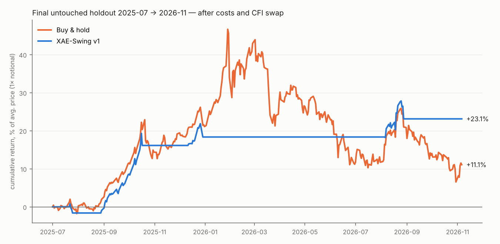

# Phase 7 — Final untouched holdout test (single run)

_Rules: `rules/xae_swing_v1.json`, frozen before this run. Code: `src/holdout.py` (run once), report `src/holdout_report.py`._
_One code defect was found and fixed after the run: the **buy-and-hold benchmark** had accidentally been given the strategy's trailing stop. This changed only the benchmark row; the strategy rules and its numbers are unchanged._

## 0. Plain-language result

* On data it had never seen (2025-07-01 → 2026-11-06, 2025-07-01 to 2026-11-06), the frozen **XAE-Swing v1** returned **+23.1%** (1× notional, after costs and the real CFI swap), with a maximum drawdown of **4.7%**, invested 19% of the time.
* Buy-and-hold over the same period returned **+11.1%** with a **40.1%** drawdown. The system stayed **flat through the peak and the crash of the first half of 2026**.
* Versus random long timing with the same trade lengths: p = **0.045** (random median +2.8%, 95th percentile +22.6%).
* **But only 4 trades**, and one trade (Aug → Oct 2025) produced 76% of the profit. The result is **consistent with the research, not proof by itself**.

## 1. Results

| mode | scenario | total_return_% | annual_return_% | annual_vol_% | sharpe | maxDD_% | trades | win_rate | exposure_% |
|---|---|---|---|---|---|---|---|---|---|
| continuous | base: $0.50/side, CFI swap | 23.11 | 17.12 | 9.46 | 1.75 | 4.70 | 4 | 0.75 | 19.37 |
| continuous | stress: $1.00/side, swap 8% | 22.26 | 16.49 | 9.42 | 1.70 | 4.72 | 4 | 0.75 | 19.37 |
| fresh start | base: $0.50/side, CFI swap | 23.11 | 17.12 | 9.46 | 1.75 | 4.70 | 4 | 0.75 | 19.37 |
| fresh start | stress: $1.00/side, swap 8% | 22.26 | 16.49 | 9.42 | 1.70 | 4.72 | 4 | 0.75 | 19.37 |
| benchmark | buy & hold (CFI swap) | 11.08 | 8.21 | 27.68 | 0.29 | 40.12 | 1 | 1.00 | 99.72 |

(‘continuous’ and ‘fresh start’ are identical because the system happened to be flat on 2025-07-01.)

## 2. Every holdout trade

| entry_day | exit_day | days | entry | exit | pnl_$/oz | R | return_% | reason |
|---|---|---|---|---|---|---|---|---|
| 2025-07-22 | 2025-07-25 | 3 | 3397.83 | 3330.68 | -67.15 | -0.67 | -1.59 | stop |
| 2025-08-29 | 2025-10-17 | 49 | 3418.00 | 4192.30 | 774.30 | 9.47 | 18.30 | stop |
| 2025-12-12 | 2025-12-29 | 17 | 4280.69 | 4384.14 | 103.45 | 0.69 | 2.44 | stop |
| 2026-08-06 | 2026-08-28 | 22 | 4247.01 | 4461.03 | 214.02 | 1.09 | 5.06 | stop |

P&L by quarter (% of average price): {'2025Q3': 8.43, '2025Q4': 9.92, '2026Q1': 0.0, '2026Q2': 0.0, '2026Q3': 4.76, '2026Q4': 0.0}

Trade P&L above is price only; the totals in §1 also include swap.

## 3. Known behaviour revealed by the holdout (not changed — rules stay frozen)

After the stop-out on 2025-12-29 the frozen rule `re_entry_after_stop` kept the system flat until a close below the 10-day low. That never happened during the January 2026 advance (daily close ≈ $4,333 on 2026-01-02 → ≈ $5,417 on 2026-01-28), so the system **missed that rally**, and for the same reason it was also **out during the subsequent fall**. In this window the rule was neutral-to-helpful; in a steadier trend it would cost money. Any change to it is a *v2* idea that can only be judged on **new data (paper trading)**, never on this holdout.

## 4. Verdict

| Question | Answer |
|---|---|
| Did the frozen rules make money out of sample? | Yes: +23.1% (stress costs + 8% swap: +22.3%) |
| Better risk-adjusted than holding gold? | Yes in this window: Sharpe 1.75 vs 0.29; drawdown 4.7% vs 40.1% |
| Statistically conclusive? | **No.** 4 trades; most profit from one trade. Combined with research (21 trades, p ≈ 0.06) the evidence is encouraging but small. |
| Ready for real money? | **Not yet.** Next: risk/position sizing (Phase 8), then forward paper trading with pre-set pass/fail criteria (Phase 9). |

**Executive verdict: REVISE → proceed to paper trading.** XAE-Swing v1 is the only idea out of ≈ 140 tested that survived development, robustness and the untouched holdout. It is a slow, low-frequency system (≈ 4–5 trades a year), not the daily scalping system originally hoped for — the data did not support one after realistic costs.
